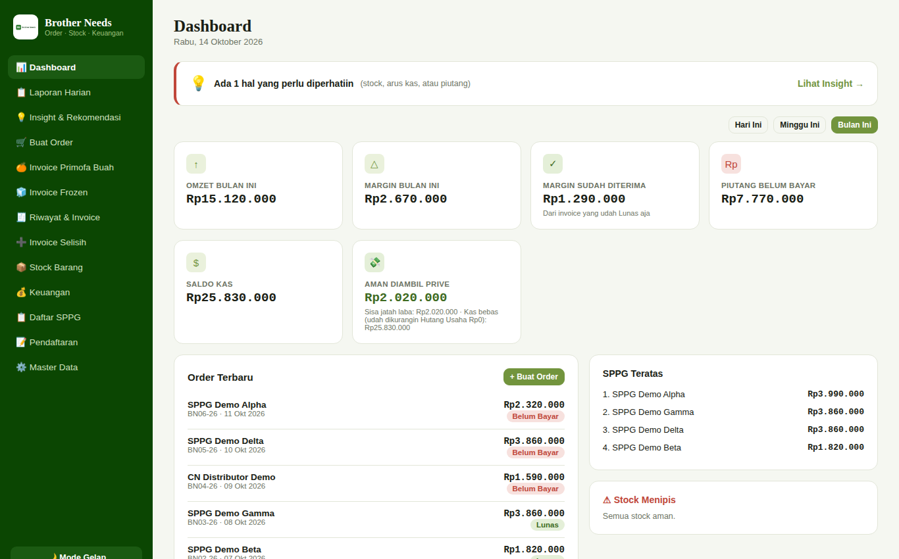
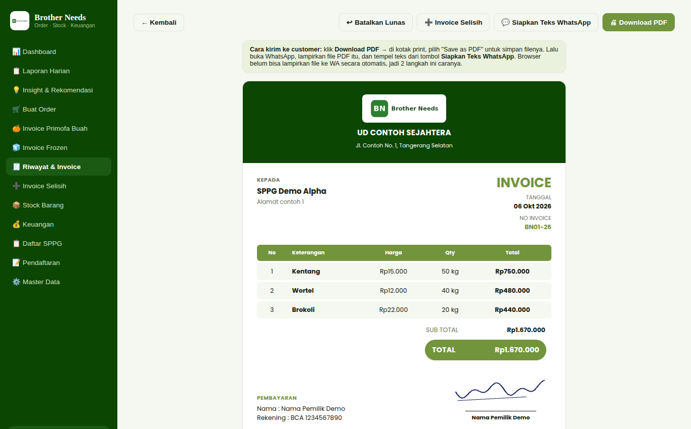
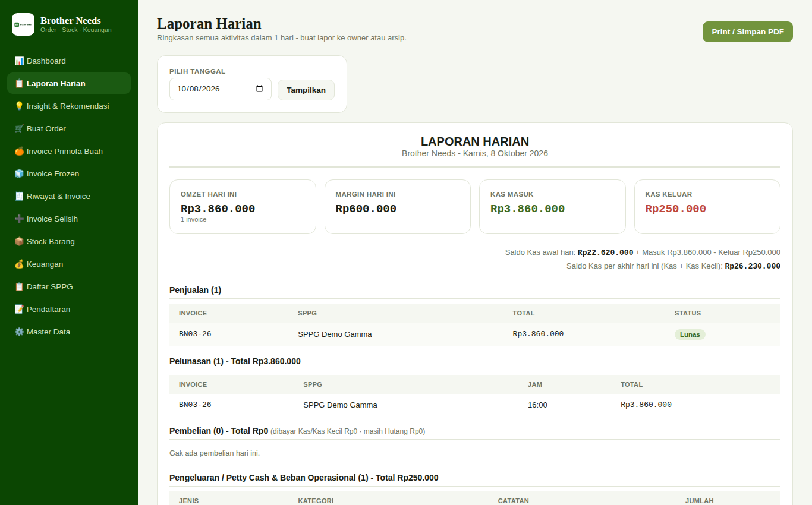
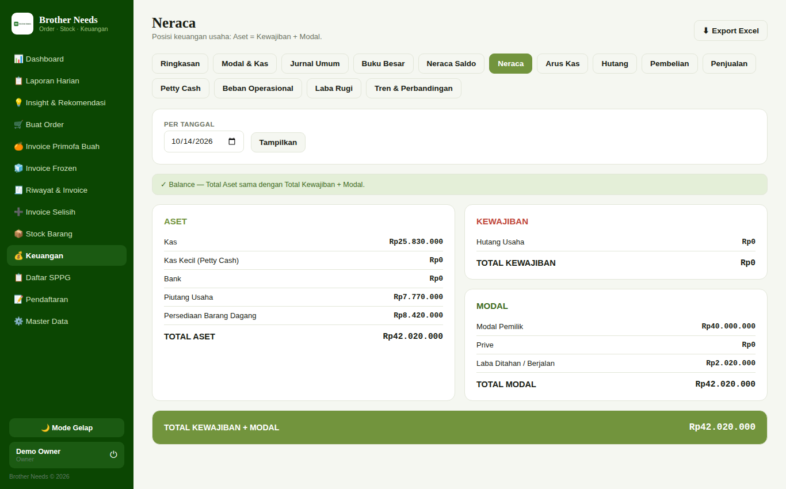
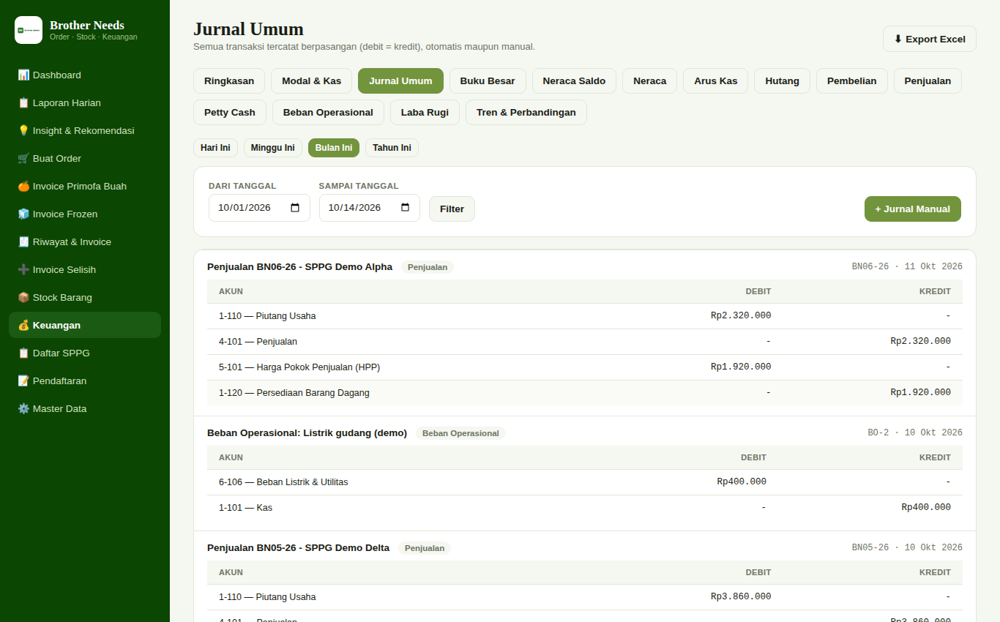
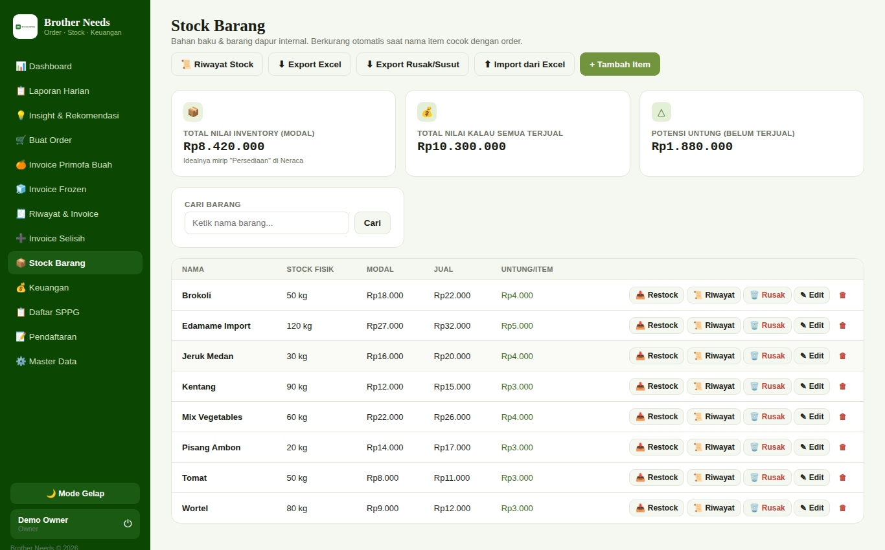

# Brother Needs ERP

> Aplikasi web **order → invoice → stock → akuntansi double-entry** untuk usaha penyedia bahan pangan (sayur, buah, frozen) yang melayani dapur SPPG/MBG. Dibangun dari nol dengan **PHP native + MySQL** dan **dipakai di bisnis nyata** (bukan project latihan).

**English summary:** A production web app for a small food-supply business: sales orders and printable invoices, stock tracking with an audit log, and a full double-entry accounting module (journals, ledger, trial balance, balance sheet, income statement, cash flow, daily report). Plain PHP 8 + PDO + MySQL, no framework. Every business transaction posts a balanced journal automatically.

Semua data di repo ini (nama, harga, rekening, saldo) **fiktif** dan dibuat khusus untuk demo.

## Screenshot (data dummy)

| Dashboard | Invoice |
|---|---|
|  |  |
| **Laporan Harian** | **Neraca (balance otomatis)** |
|  |  |
| **Jurnal Umum** | **Stock Barang** |
|  |  |

## Fitur

**Penjualan**
- Buat order per SPPG/customer, harga jual dan modal per item, margin otomatis.
- Invoice siap cetak/PDF + teks WhatsApp; 3 jenis invoice (utama, buah, frozen) dengan seri nomor dan kop terpisah.
- Pelunasan wajib upload bukti transfer. Ada pengaman supaya tombol "Tandai Lunas" tidak bisa mencatat jurnal dobel.
- Invoice "Selisih" untuk menagih selisih barang, bisa export Excel.

**Stock**
- Stock otomatis berkurang saat penjualan dan bertambah saat pembelian.
- Riwayat stock (log tiap perubahan: sebelum, sesudah, sumber), edit stock manual, catat susut, import dari Excel.
- Setiap penyesuaian stock ikut menghasilkan jurnal penyesuaian persediaan.

**Akuntansi**
- Jurnal otomatis dari penjualan, pelunasan, pembelian, beban, petty cash, dan modal.
- Jurnal umum, buku besar, neraca saldo, neraca, laba rugi, arus kas, tren, hutang dan talangan.
- Laporan Harian: omzet, margin, kas masuk/keluar per jurnal, saldo kas awal/akhir hari.
- Insight: peringatan stock menipis, piutang, dan arus kas.

**Lainnya:** login Owner/Admin, master produk dan SPPG (import Excel tanpa library tambahan, pakai `ZipArchive`), halaman pendaftaran mitra, mode gelap, layout responsif.

## Desain teknis yang menarik

- **Double-entry di satu pintu.** Semua modul memanggil `post_jurnal()` (`includes/jurnal_helper.php`). Fungsi ini menolak jurnal yang tidak balance atau punya akun yang tidak ada di COA, sehingga ledger tidak bisa timpang.
- **Konsistensi lintas modul.** Edit order, edit pembelian, dan penyesuaian stock menghapus lalu memposting ulang jurnalnya dalam satu alur, supaya stock, persediaan, dan piutang tetap sinkron.
- **Anti double-submit.** `tandai_lunas.php` memakai `UPDATE ... WHERE status='Belum Bayar'` dan memeriksa `rowCount()`, ditambah cek jurnal yang sudah ada. Ini ditambahkan setelah ditemukan pelunasan yang tercatat dua kali di data produksi.
- **Laporan Harian berbasis jurnal.** Arus kas dihitung dari efek bersih tiap jurnal terhadap Kas dan Kas Kecil, jadi mutasi antar-kas tidak dihitung sebagai pemasukan atau pengeluaran.
- **Tanpa framework dan tanpa Composer.** Mudah di-deploy di shared hosting (Hostinger) maupun XAMPP.

Stack: PHP 8, PDO (prepared statements), MySQL/MariaDB, HTML/CSS/JS murni.

## Cara menjalankan (XAMPP / localhost)

1. Copy folder ini ke `htdocs/brother-needs-erp`.
2. Start **Apache** dan **MySQL**.
3. Di phpMyAdmin, import berurutan: `database/schema.sql` lalu `database/seed_demo.sql` (membuat database `brother_needs` beserta data dummy).
4. Copy `config/database.example.php` menjadi `config/database.php`, lalu sesuaikan user dan password MySQL.
5. Buka `http://localhost/brother-needs-erp/` dan login:
   - **demo** / **demo123** (Owner)
   - **admin** / **demo123** (Admin)

Untuk pemakaian sungguhan, ganti password lewat **Master Data → Kelola User**, dan jangan pernah commit `config/database.php`.

## Struktur singkat

```
index.php, order.php, invoice.php, riwayat.php   penjualan & invoice
stock*.php                                       stock, riwayat, susut, import
keuangan*.php, laporan_harian.php                modul akuntansi & laporan
selisih*.php                                     invoice selisih
master_*.php                                     data master & user
includes/                                        auth, helper jurnal, layout
database/                                        schema.sql + seed_demo.sql
```

## Catatan

Proyek ini berasal dari bisnis nyata yang dimiliki pihak lain, dipublikasikan dengan izin pemilik. Data asli, kredensial, logo, dan tanda tangan asli sudah dihapus dan diganti placeholder.
